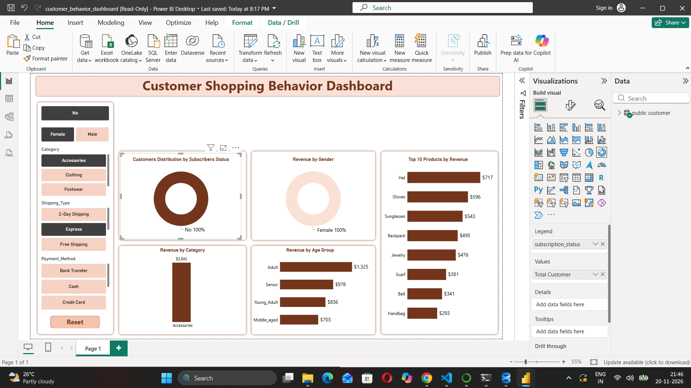

# Customer Shopping Behavior Analysis

An end-to-end Data Analytics project using **Python, SQL, and Power BI** to analyze customer shopping behavior, identify purchasing patterns, and generate actionable business insights.

## 📊 Power BI Dashboard

The interactive dashboard provides insights into customer demographics, revenue distribution, product performance, subscription status, and purchasing preferences.

## 📌 Project Overview

This project analyzes customer shopping behavior to understand purchasing patterns, product preferences, discount utilization, subscription status, and customer demographics.

The objective is to transform raw customer transaction data into meaningful business insights that can help retailers understand their customers and make data-driven decisions.

## 📁 Dataset Description

The dataset contains **3,900 records and 18 original columns**, covering:

- Customer demographics, including age, gender, and location.
- Product categories and purchased items.
- Purchase amounts and previous purchases.
- Purchase frequency and subscription status.
- Customer review ratings.
- Payment and shipping methods.
- Discount usage and seasonal shopping preferences.

## 🛠️ Tools & Technologies

| Tool | Purpose |
|---|---|
| Python | Data exploration and preprocessing |
| Pandas | Data manipulation and cleaning |
| Jupyter Notebook | Interactive analysis |
| SQL | Database management and business analysis |
| Power BI | Dashboard development and visualization |
| GitHub | Project documentation and version control |

## 🔄 Project Workflow

### 1. Data Exploration & Cleaning – Python

- Explored the dataset and examined its structure.
- Inspected data types and summary statistics.
- Identified and handled missing review ratings.
- Standardized column names.
- Created additional analytical features for customer segmentation.

### 2. Business Analysis – SQL

Performed SQL-based analysis to investigate:

- Customer segmentation and purchasing behavior.
- Revenue generated by different products.
- Revenue distribution across product categories.
- Subscription status and customer purchasing patterns.
- Discount usage and promotional activity.
- Customer shipping and payment preferences.
- Shopping behavior across different age groups.
- Product ratings and customer feedback.

### 3. Dashboard Development – Power BI

Developed an interactive dashboard to visualize customer shopping patterns.

**Dashboard Highlights:**

- Customer Distribution by Subscription Status.
- Revenue by Gender.
- Top Products by Revenue.
- Revenue by Category.
- Revenue by Age Group.
- Interactive filters for Gender, Category, Shipping Type, and Payment Method.
- Reset button to clear dashboard filters.

## 💡 Business Applications

The analysis can help businesses:

- Understand customer purchasing behavior.
- Identify popular products and revenue-generating categories.
- Explore customer segmentation and subscription patterns.
- Evaluate promotional and discount strategies.
- Understand shopping preferences across demographics.
- Support data-driven retail and marketing decisions.

## 📂 Project Files

- Python analysis notebook (`.ipynb`)
- SQL business analysis scripts (`.sql`)
- Power BI dashboard (`.pbix`)
- Dataset (if included in the repository)

## 👨‍💻 Author

**Shahil Ahmed MF**

- GitHub: [shaz-code](https://github.com/shaz-code)
- Location: Bengaluru, India

---

⭐ If you find this project interesting, feel free to explore the repository!
